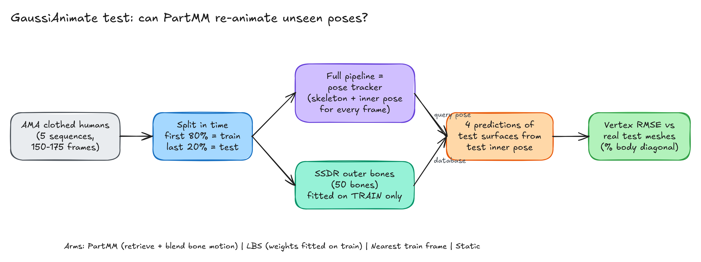
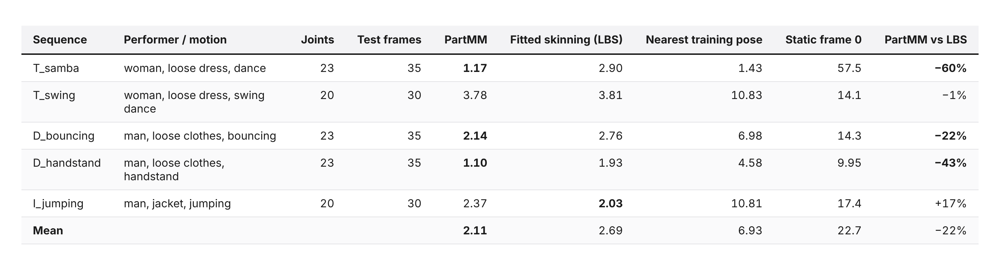

# PartMM vs skinning on unseen poses (GaussiAnimate, AMA clothed humans, CPU-only)

This is an independent, pre-registered test of **PartMM**, the partwise motion matching from [GaussiAnimate](https://github.com/Net-Maker/GaussiAnimate) (SIGGRAPH Asia 2026, MIT). It runs on public AMA mesh sequences on a CPU-only box. For held-out (later) frames of each sequence, it asks whether PartMM rebuilds the clothed surface from the inner skeleton pose better than fitted linear blend skinning, and better than copying the nearest whole-body training pose.



## Result (n = 5 sequences, 80/20 temporal split, 95% bootstrap CI)
| Hypothesis | Mean reduction in held-out vertex RMSE by PartMM | 95% CI | Verdict |
|---|---:|---:|---|
| H1: vs fitted skinning (LBS), bar ≥ 10% | 21.8% | −1.9% … 45.5% | **INCONCLUSIVE** (4/5 wins) |
| H2: vs nearest whole-body pose | 61.3% | 38.9% … 75.5% | **PROVEN** (5/5 wins) |

Sanity check: PartMM and LBS beat a static mesh on 5/5. Secondary (descriptive): dynamic-region RMSE vs LBS was 34.0% lower (11.5% … 56.6%).



Full numbers: `results/summary.json` and `run/full/<case>/metrics.json`. Error renders: `figures/compare_<case>_sheet.png` and `.gif`.

## What's here
| Path | What |
|---|---|
| `PREREGISTRATION.md` | hypotheses, arms, metric and decision rules, written before any run; Clarification 1; Amendment 1 (scope cut to 5) |
| `DESIGN.md` | scouting notes and the first design |
| `scripts/eval_sequence.py` | one sequence end to end: extraction (pose tracker) → train-only SSDR → PM / LBS / NN / STATIC → metrics |
| `scripts/fast_tracking.py` | parallel, bit-identical replacement for the per-frame surface-IK loop (see issues-found/01) |
| `scripts/test_fast_tracking.py` | equivalence test (max Δ = 0.0) |
| `scripts/run_seq_one_at_a_time.sh` | the sequential runner that was used |
| `scripts/analyze.py` | bootstrap, verdicts, figures |
| `scripts/render_compare.py` | GT / PartMM / LBS / NN renders coloured by error |
| `issues-found/` | what broke and how it was handled |
| `_agent_logs/` | timestamped process log |
| `blog/post.md` | the write-up |

## How to reproduce
```bash
sudo apt install build-essential cmake libcgal-dev libeigen3-dev        # CGAL 6.0.1 worked
git clone https://github.com/Net-Maker/GaussiAnimate && cd GaussiAnimate && git checkout 2012a6e
uv venv --python 3.10 .venv && . .venv/bin/activate
uv pip install -e '.[geometry,visualization,ssdr,dev]' pybind11
bash scripts/install_geometry.sh                                         # pyssdr + CGAL curve_skeleton
# AMA meshes (Vlasic et al. 2008, public): https://people.csail.mit.edu/drdaniel/mesh_animation/
#   unpack to <this repo>/data/AMA/<case>/meshes/mesh_*.obj
export PYTHONPATH=$PWD OMP_NUM_THREADS=4 GA_TRACK_PROCS=4
python <this repo>/scripts/eval_sequence.py T_samba <this repo>/run/full/T_samba
python <this repo>/scripts/analyze.py && python <this repo>/scripts/render_compare.py T_samba
```
Measured on a shared 8-core / 16 GB box: 12–25 min per sequence with the parallel tracking (70 min sequential), and about 2.5 GB peak RAM.

## Limitations
- n = 5 of the 10 AMA sequences. This was a user time cut, pre-registered as Amendment 1 before the new sequences were scored.
- The pose tracker saw all frames, so tracking had access to the test surfaces. It's identical for all arms, but absolute errors are optimistic.
- This doesn't reproduce the paper's benchmark: the VTO data and the Gaussian checkpoints aren't freely available.
- Default configs only, no tuning.
