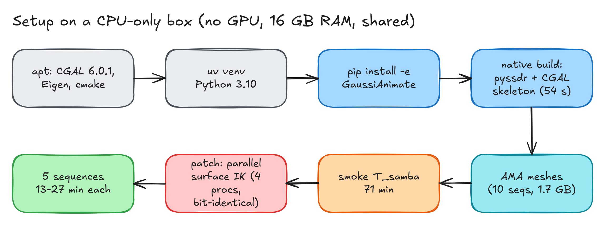
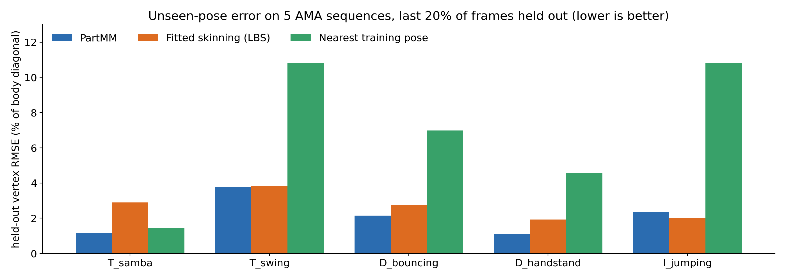
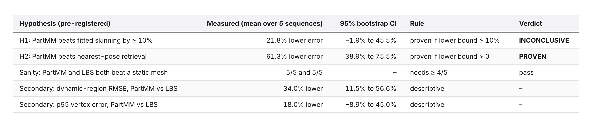
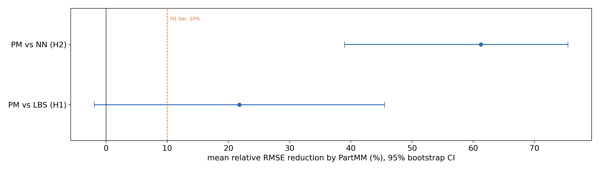
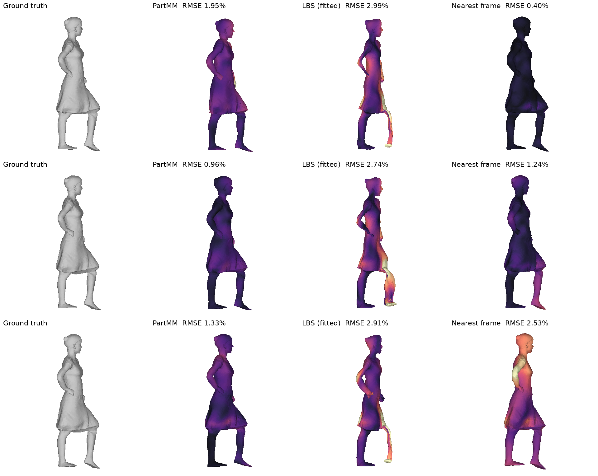
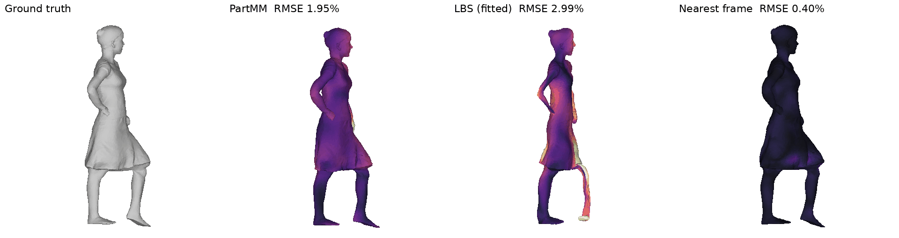
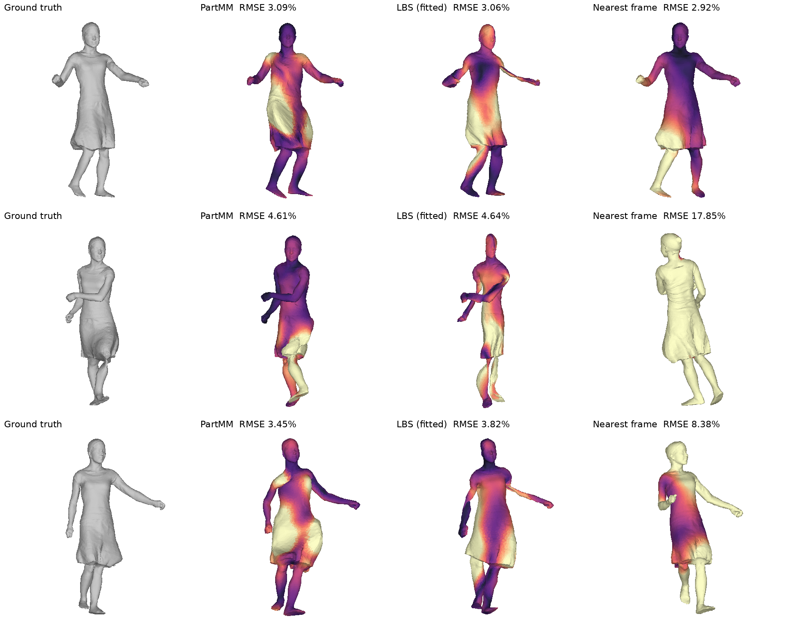
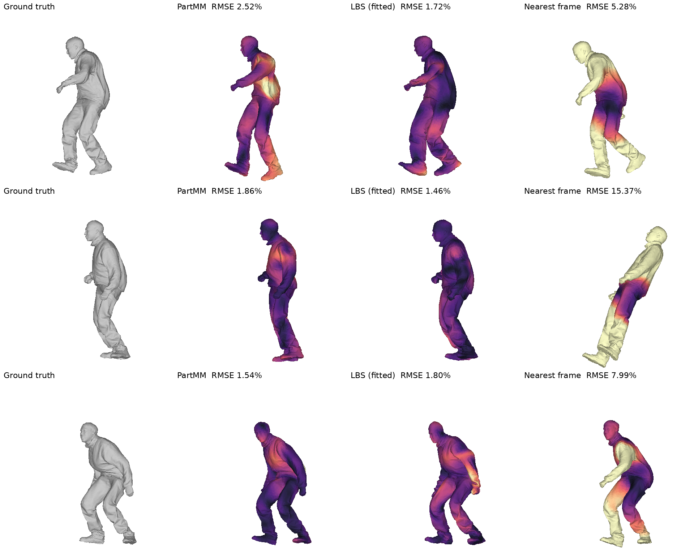
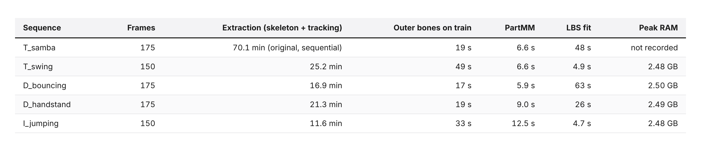

# Does GaussiAnimate's motion matching beat plain skinning on poses it hasn't seen?

*CPU-only test on 5 public clothed-human sequences. Partwise motion matching cut held-out error 61% vs nearest-pose retrieval. Vs fitted skinning: 22% better, not conclusive.*


*The test. Every method gets the same inner skeleton pose for frames it has never seen, then predicts the full clothed surface for those frames.*

## The short version

- **The paper:** [GaussiAnimate](https://github.com/Net-Maker/GaussiAnimate) (SIGGRAPH Asia 2026, MIT licence). It learns a skeleton from a moving 3D sequence, then re-animates it with **PartMM**: *partwise motion matching*. For a new pose, each body part looks up how it moved in similar frames, and those motions are blended.
- **My question:** for poses the method has **not** seen, does PartMM rebuild the clothed surface better than (a) classic skinning fitted to the same frames and (b) simply copying the closest whole-body pose?
- **Data:** 5 sequences from the public [AMA dataset](https://people.csail.mit.edu/drdaniel/mesh_animation/): two in a loose dress (samba, swing), two in loose clothes (bouncing, handstand) and one in a jacket (jumping). The first 80% of frames are the database and the last 20% are the test.
- **vs nearest pose (H2):** PartMM had **61% lower error** (95% CI 39–75%). **Proven**, and it won on all 5 sequences.
- **vs fitted skinning (H1):** PartMM had **22% lower error** on average (CI −2% to +45%). My bar was "at least 10%". The lower end of the interval falls below it, so this is **inconclusive**. It won 4 of 5; skinning won on the jumping sequence.
- **Cloth surprise:** I expected the dress sequences to favour PartMM. Samba did (−60%), but swing was a tie (−1%).
- **Compute:** a CPU-only Linux box, no GPU. Most of the time went to one tracking step (70 min for the first sequence). I parallelised it without changing a single number.

Thanks for reading Tech in General! Subscribe for free to receive new posts and support my work.

## What GaussiAnimate does

GaussiAnimate takes a moving 3D object, a sequence of point clouds or meshes. It builds two layers of "bones":

- **Outer bones:** 50 small rigid pieces fitted to how the surface moves. They come from SSDR, a classic skinning-decomposition method.
- **Inner skeleton:** a normal joint tree (shoulders, knees and so on), extracted from the shape with a curve-skeleton algorithm. Each frame is then tracked so the joints sit inside the surface.

To animate a new pose, **PartMM** takes the inner joint angles and splits the body into parts. For each part it finds the training frames where that part was posed most similarly and blends their outer-bone motion. Because it reuses real recorded motion, it can in principle bring back cloth wrinkles and swing that a plain skeleton can't express.

The paper reports 48% lower error than robust skinning on a garment dataset. That dataset needs a licence form, so I tested the same idea on data anyone can download.

## What I tested

- **5 sequences, 150–175 frames each, about 10,000 vertices each.** Every mesh is scaled so its frame-0 bounding-box diagonal is 1. Errors are therefore "percent of body size".
- **Split in time:** the first 80% of frames are the database and the last 20% are the test (30–35 frames per sequence). The test poses come later in the motion, so they really are new.
- **Same query for everyone:** the full GaussiAnimate pipeline is run once per sequence, only as a *pose tracker*. Each method gets the test frame's inner joint angles and nothing else.
- **Outer bones re-fitted on train frames only.** No method sees a test surface.
- **Four methods:**
  - **PartMM:** the paper's method, default settings.
  - **Fitted skinning (LBS):** linear blend skinning on the same inner skeleton. Per-vertex weights are solved by non-negative least squares on all train frames, which is the best skinning those frames allow.
  - **Nearest training pose:** copy the whole-body training frame with the most similar joint angles, moved to the current root position.
  - **Static:** frame 0, as a floor.
- **Metric:** per-vertex RMSE against the real test meshes, averaged over test frames.
- **Pre-registered:** hypotheses, thresholds and the bootstrap (10,000 resamples over sequences) were written down before any scoring. The scope cut from 10 to 5 sequences was added as an amendment before the new sequences were scored. Details are in the limitations section.

## Setup: getting a 2026 graphics repo running on a CPU box


*Eight steps from a clean box to results. The only real obstacle was runtime.*

- **System libraries:** `apt install build-essential cmake libcgal-dev libeigen3-dev`. The repo doesn't pin a CGAL version, and the box had **CGAL 6.0.1**. The curve-skeleton tool built cleanly with it in 54 s.
- **Python:** the repo needs Python 3.8–3.11 and NumPy below 1.26; the box has 3.13. `uv venv --python 3.10`, then `uv pip install -e '.[geometry,visualization,ssdr,dev]'` installed numpy 1.25.2 and open3d 0.19.
- **Native builds:** `scripts/install_geometry.sh` builds `pyssdr` (Dem Bones via pybind11) and the CGAL `curve_skeleton` binary.
- **Data:** the 10 AMA sequences as public archives, 1.7 GB unpacked. No forms.
- **Test run on the repo's own example (T_samba): 71 minutes.** Almost all of it was one step: `refine_motion_with_surface`, which solves a small constrained optimisation (SLSQP) per frame to keep the joints inside the surface. That's 16–26 s per frame, single-threaded, on a box shared with other jobs.

### What broke, and the fix

At 70 minutes per sequence, all 10 sequences would have taken about 12 hours. The frames are solved one after another, but each solve depends only on its own frame's data. So I wrote a small wrapper, `fast_tracking.py`:

1. Run the **unmodified** original function once in "record" mode to capture the exact arguments of every per-frame solve.
2. Solve those calls on a pool of 4 processes.
3. Put the results back in order.

Before using it, I checked it on 8 frames against the original: **maximum difference 0.0** in every joint rotation and root position, so bit-identical. After that, extraction took 12–25 min per sequence instead of 70.

Other small snags:

- `/usr/bin/time` was missing, so I timed with bash `time`.
- A foreground build was interrupted and was re-run in the background.
- Several agents shared the box (load average 15–55), so all timings here are pessimistic.

## Results


*Held-out vertex RMSE, % of body diagonal (lower is better). Last column: PartMM's error relative to fitted skinning.*


*Same numbers as a chart. The static baseline is left out (10–58%) so the others are readable.*


*Pre-registered verdicts. n = 5 sequences, paired, 95% percentile bootstrap.*


*PartMM's mean error reduction with 95% CIs. The dashed line is my pre-registered 10% bar for H1.*

### Result 1: partwise matching clearly beats whole-body retrieval

Copying the nearest whole-body training pose was the worst real method on 4 of 5 sequences. It had 7–11% error on swing, jumping and bouncing. Those motions don't repeat exactly, so no single training frame matches the whole body.

PartMM solves exactly that. The left arm can borrow from one frame and the legs from another. It beat whole-body retrieval on **all 5 sequences**, with a mean reduction of 61% (CI 39–75%).

The exception that proves the rule is **samba**. It's a repetitive dance, so the nearest-pose copy was already good (1.43%), and PartMM's lead shrank to 18%.

### Result 2: against fitted skinning, a likely win that I can't call

PartMM beat fitted skinning on 4 of 5 sequences:

- samba −60%
- handstand −43%
- bouncing −22%
- swing −1%, a tie
- jumping +17%, skinning won

The mean is 22% better, but with five sequences that differ this much, the 95% interval runs from −2% to +45%. My bar was that the *lower end* clears 10%. It doesn't, so H1 is **inconclusive**, not proven.

One secondary number points the same way. On the 20% of vertices that skinning struggles with most (the loose cloth regions), PartMM's error was 34% lower (CI 11–57%). I fixed that as descriptive in advance, so it isn't a verdict.

### What it looks like


*T_samba, three held-out frames. Colour = per-vertex error; black is 0 and bright yellow is 5% of body size or more. PartMM stays close everywhere, dress included. Fitted skinning visibly distorts the trailing leg and the arms.*


*All held-out samba frames, playing.*


*T_swing, the tie. The swinging dress is the hard part for **both** PartMM and skinning.*


*I_jumping, where skinning wins. PartMM shows patchy errors on the torso and jacket, where blended part motions disagree.*


### Why the dress didn't always help PartMM

I expected cloth to be PartMM's best case, since reusing recorded motion should bring back skirt swing. On samba it did. On swing, the error maps show both methods failing in the same place: the flaring hem. My likely explanation, which I didn't test separately, is that the held-out end of the dance swings the dress in ways the first 80% doesn't contain.

Motion matching can only reuse motion it has seen. When the needed cloth motion isn't in the database, it does no better than skinning. That's a limit of the database rather than the method, and it's honest to say a temporal split is a hard test for it.

## Runtime and memory


*Per-stage wall-clock time on the shared CPU box. T_samba's extraction ran before the parallel patch.*

- **PartMM itself is fast:** 6–13 s for the whole test set of a sequence, in pure NumPy.
- **The cost is all in building the skeleton,** above all the per-frame surface tracking.
- **Peak RAM:** about 2.5 GB per sequence.

## How to reproduce

All the code is in the repo: [github.com/nankris/partmm-vs-skinning-unseen-poses](https://github.com/nankris/partmm-vs-skinning-unseen-poses).

```bash
sudo apt install build-essential cmake libcgal-dev libeigen3-dev
git clone https://github.com/Net-Maker/GaussiAnimate && cd GaussiAnimate && git checkout 2012a6e
uv venv --python 3.10 .venv && . .venv/bin/activate
uv pip install -e '.[geometry,visualization,ssdr,dev]' pybind11
bash scripts/install_geometry.sh
# AMA: download the mesh archives from the project page into data/AMA/<case>/meshes/
python <repo>/scripts/eval_sequence.py T_samba run/full/T_samba   # one sequence, ~12-70 min on CPU
python <repo>/scripts/analyze.py                                   # bootstrap + verdicts + figures
python <repo>/scripts/render_compare.py T_samba                    # comparison sheet + GIF
```

- `eval_sequence.py` imports the parallel tracking patch automatically. Set `GA_TRACK_PROCS` to the number of processes you can spare.
- `scripts/test_fast_tracking.py` re-checks that the patch is bit-identical.

## Limitations

- **5 sequences, not 10.** I cut the scope to get this out the same day, and the reduction was pre-registered as an amendment before any of the new sequences were scored. I picked the 3 added sequences for variety and cloth (all three performers, an inverted pose, both dress sequences), not for results. The 5 not run are D_march, D_squat, I_crane, I_march and I_squat. n = 5 is why the H1 interval is so wide.
- **Not the paper's benchmark.** The garment dataset and the Gaussian-splat checkpoints aren't freely available. This is a fresh test of the core idea, not a reproduction of the 48% number.
- **Shared pose tracker.** The inner skeleton and the test-frame joint angles come from running the pipeline on the full sequence, so tracking saw the test surfaces. All methods get the same query, so the comparison stays fair, but absolute errors are optimistic.
- **The skinning baseline is strong.** Its weights are fitted to all training frames, unlike the heuristic weight transfer often used as a baseline. That's deliberate, and it's one reason the gap is smaller than the paper's.
- **Default settings everywhere,** with no tuning per sequence.
- **Timings come from a shared, heavily loaded box.** Expect them to be faster on a quiet machine.

## Bottom line

Partwise motion matching does what it says on the box. Letting each body part borrow motion from a different moment beats copying whole poses by a wide margin.

Against well-fitted skinning it is *probably* better, by about a fifth on average, and clearly better on the samba dress. But on five sequences that's a lean, not a result. More sequences, or ones where the test poses stay inside what the database has seen, would settle it.
